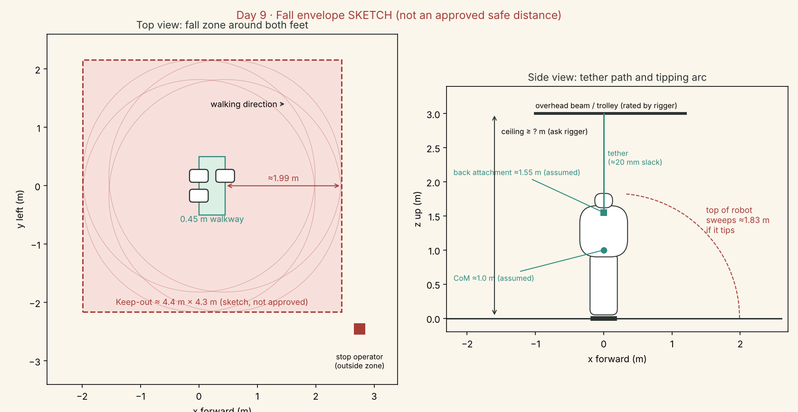

# Day 9 · Robot fall hazards

**R0.3 · 2026-11-02 · Owner: Faisal Farouq**
Day 9 result: **PASS** (desk work: hazard questions only). No rating, safe distance or anchor is approved here.

## The short version

- A 55 kg, 1.83 m robot that tips over can reach about **2 m** from its feet and hit the floor with roughly **540 J**: the same as dropping 55 kg from 1 m.
- A **keep-out zone of about 4.4 × 4.3 m** around the 0.45 m walkway is the starting sketch. A rigger and test reviewer set the real one.
- Two different things stop a fall. **Balance control** (software and motors) keeps the robot upright. **Fall arrest** (overhead tether) catches it when balance fails, including when power is cut. Each is tested separately.
- The tether has to **move with the robot**. A fixed overhead point tilts the tether as the robot walks, and a fall at the end of the walkway would swing it back like a pendulum.
- **Slack decides the catch load.** In an illustrative screen (not for choosing equipment), 20 mm of slack gives ≈1,600 N and 200 mm gives ≈11,300 N.

## Inputs

- `risk_records/hazards.csv`: JB-H-01 (fall or arrest failure), JB-H-14 (tether snag or assistance), JB-H-17 (power removal drops the load), JB-H-20 (friendly look draws people close).
- `cad_specifications/parameters.json`: 1.829 m, 55 kg, feet 0.32 × 0.22 m, 0.34 m apart.
- `requirements/day_006_D03_D04_configuration.md`: tether slack 20 mm and CoM 1.0 m (both assumed).
- `simulation` plan: walkway 0.45 m (three steps of ≈0.15 m).

## Numbers

| Item | Working | Result | Status |
|---|---|---|---|
| Static weight | 55 × 9.81 | **539.55 N** | Target mass |
| Tipping reach from foot centre | 1.829 height + 0.16 half-foot | **≈1.99 m** | Sketch |
| Keep-out rectangle | length 0.45 + 2 × 1.99; width 0.34 + 2 × 1.99 | **≈4.4 m × 4.3 m** | Sketch, not approved |
| Untethered fall energy | 55 × 9.81 × 1.0 m CoM drop | **≈540 J** | CoM assumed |
| Catch force, illustrative only | m·g·(1 + slack ÷ stretch), stretch 0.01 m | 20 mm → 1,619 N · 50 mm → 3,237 N · 200 mm → 11,331 N | **Not for equipment selection** (ignores rope stiffness, peaks, geometry) |

The last row shows why slack matters, nothing more. The rigger calculates the real peak load.

### Tether angle if the overhead point does not move

Back attachment ≈1.55 m above the floor (assumed). Tether length L = ceiling anchor height − 1.55 m.

| Anchor height | L | Anchor at walkway start (robot moves 0.45 m) | Anchor over the walkway middle (±0.225 m) |
|---|---:|---:|---:|
| 2.6 m | 1.05 m | 23.2° | 12.1° |
| 3.0 m | 1.45 m | 17.2° | 8.8° |
| 3.5 m | 1.95 m | 13.0° | 6.6° |

**Recommendation to put to the rigger:** a rated trolley on a beam or track along the walkway, so the tether stays vertical. If a fixed point is the only option, put it over the walkway middle with the highest ceiling available, and record the angle.

## The arrest path: one question per part

| Part | Question | Evidence to get | Who answers |
|---|---|---|---|
| Robot attachment point | Where on the frame (not the shell) does the tether connect, and what load can that bracket take? | Bracket drawing with rated load | Mechanical reviewer (Day 199) |
| Tether / lanyard | What length, material, slack and stretch? What drop before it catches? | Datasheet; slack set at install | Rigger |
| Connectors | Which shackles or carabiners, and their working load limit? | Marked ratings; inspection record | Rigger |
| Trolley or overhead point | Fixed point or trolley along the walkway? Rated load? | Product rating; install record | Rigger |
| Beam / frame | Is the beam or portable gantry rated for the arrest load? | Rating plate or engineer's letter | Rigger / building owner |
| Building anchor | What is it fixed into, and who approved it? | Written approval from the facility | Facility owner |
| After a catch | How do you lower and recover a 55 kg robot hanging on the tether? | Written recovery steps; second person | Rigger + you |

Note: fall gear made for people (harnesses and lanyards, ANSI/ASSP Z359 family) is designed and tested for people. It is not assumed suitable for a robot. Use it only if the rigger approves that exact use in writing.

## Site checklist (fill in on Day 134)

| Item | Need (starting value) | Measured |
|---|---|---|
| Clear floor area | ≥ 4.4 m × 4.3 m plus a walkway for people outside it | |
| Ceiling or beam height | Ask rigger; the table above assumes 2.6–3.5 m | |
| Overhead structure | Beam, track or gantry the rigger can rate | |
| Floor | Flat, hard, dry; note the material (friction test, Day 117) | |
| Power outlets | Within cable reach, outside the keep-out zone | |
| Barrier | Rope or panels at the keep-out line | |
| Spectator line | Behind the barrier; remote screen if people want to watch (JB-H-20) | |
| Stop operator position | Outside the zone, with the e-stop in reach and a clear view of the robot | |
| E-stop reach | Wired e-stop cable ≥ 2.5 m, or a rated wireless stop | |
| Lighting and cameras | Room for 2 fixed cameras (side, front) outside the zone | |

## How each hazard is covered

| Hazard | What today adds | Still needed |
|---|---|---|
| JB-H-01 fall / arrest failure | Keep-out sketch; arrest-path questions | Rated arrest design and inspection (Days 135–137, 258) |
| JB-H-14 tether snag / assistance | Trolley vs fixed-point angles; load cell in the tether to show how much it helps (Day 146) | Rigger's routing; acceptable assistance set before gait tests (Day 281) |
| JB-H-17 power loss drops the robot | Arrest must hold with all power off; the robot's motors are never trusted to hold it | Power-off test on the support (Day 235) |
| JB-H-20 people walk up to it | Barrier, spectator line, stop operator outside the zone | Briefing script before each test |

## Outside help

| When | Who | What to get |
|---|---|---|
| Day 135 | A qualified rigger or a structural engineer | Written arrest design: anchor, trolley, tether, slack, ratings, inspection |
| Day 134 | Owner or manager of a test space | Written permission, hours, ceiling or beam details, cost |

No one is named yet (D-02).

## Checks

| Check | Result |
|---|---|
| Fall envelope drawn and labelled as a sketch | PASS |
| Arrest and balance control described separately | PASS |
| Every arrest part has a question, the evidence needed and who answers | PASS |
| No anchor capacity, safe distance or arrest rating presented as approved | PASS |

Sources: R0.1 hazard register (JB-H-01, 14, 17, 20); R0.1 engineering baseline p. 8 (the energy screen m·g·(1 + h/d), which R0.1 notes must not be used to select equipment); Day 6 R0.3 assumptions A6-01 and A6-12.
